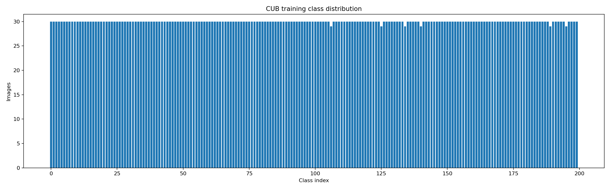
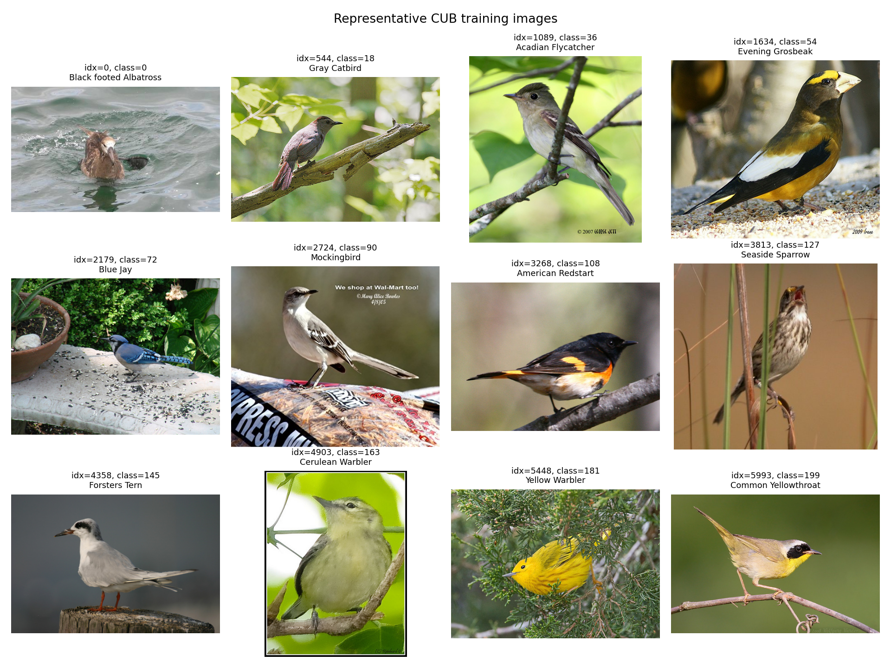
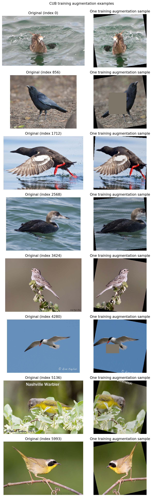
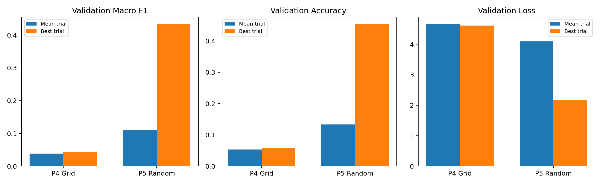
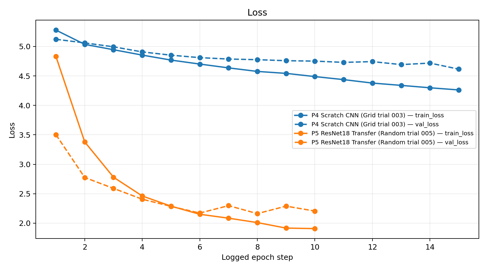
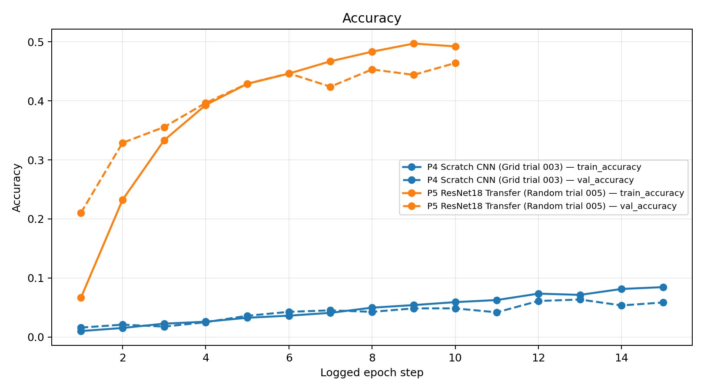
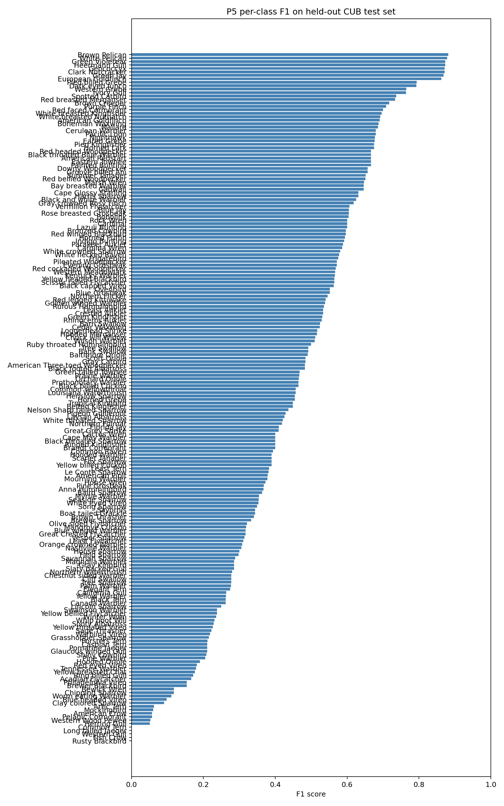
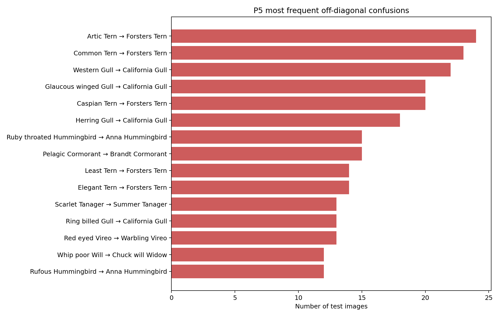
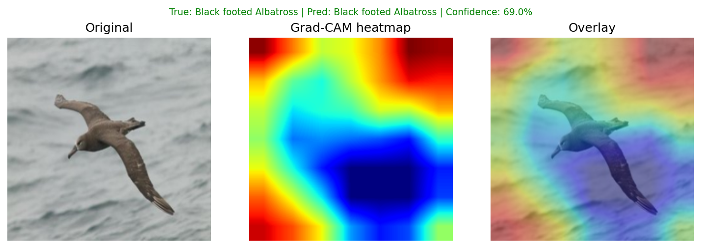
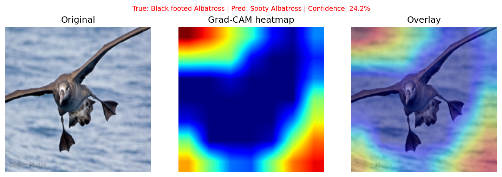

# From Pixels to Language: CUB-200-2011
## Milestone 1 Report - Image Classification

**Project:** CSE Deep Learning Final Project

**Dataset:** CUB-200-2011 via `Multimodal-Fatima/CUB_train` and `Multimodal-Fatima/CUB_test`

**Report scope:** Milestone 1 classification, search, evaluation, explainability, and data-quality work

**Environment:** Python 3.14, PyTorch 2.9.1+cu128, torchvision 0.24.1+cu128, NVIDIA RTX 3050 Laptop GPU

> This report is assembled from persisted repository artifacts and MLflow records. No model was retrained for report preparation. Historical legacy results and the corrected leakage-safe P5 result are labeled separately.

## 1. Introduction

The project studies fine-grained bird classification as the first stage of “From Pixels to Language.” Milestone 1 establishes a reproducible image-encoder workflow on the 200-class CUB-200-2011 bird dataset. It covers dataset inspection, preprocessing and augmentation, a convolutional network trained from scratch, ImageNet transfer learning, exhaustive Grid Search, seeded Random Search, MLflow tracking, held-out evaluation, error analysis, and Grad-CAM explanations.

The classification task maps an input bird image to one of 200 species classes. Image colorization and image captioning are Milestone 2 objectives and are not claimed complete here.

## 2. Dataset Description

The training source is the Hugging Face dataset `Multimodal-Fatima/CUB_train` (`train` split), with 5,994 images and 200 `ClassLabel` classes. The untouched test source is `Multimodal-Fatima/CUB_test` (`test` split), with 5,794 images. Class names and class-to-index mappings are taken from the dataset metadata and were checked for consistency between training and test.

Each training image has ten associated captions (59,940 raw captions). Caption artifacts are used for analysis only; captions are not inputs to the Milestone 1 classifier.

Two split generations must be distinguished:

| Split generation | Train | Validation | Use |
|---|---:|---:|---|
| Legacy random split (`seed=42`) | 4,796 | 1,198 | Historical P4/P5 searches and their original evaluations |
| Corrected `stratified_group_v2` | 4,794 | 1,200 | Corrected P5 training and final corrected P5 test evaluation |
| Untouched test split | - | - | 5,794 images, used only for final evaluation |

## 3. Exploratory Data Analysis

Persisted EDA is under `outputs/eda/`.

- Class counts range from 29 to 30 in the 5,994-image training source; no class is missing.
- Image widths range from 121 to 500 pixels and heights from 120 to 500 pixels.
- Channel modes are RGB for 5,990 images and grayscale (`L`) for 4 images.
- No corrupted or missing images were detected.
- Caption analysis found 59,940 captions, raw vocabulary size 6,690, cleaned vocabulary size 4,086, 1,879 hapax words, 27 non-ASCII captions, 641 within-image duplicate captions, and 13,448 captions without a final period.
- 506 caption typo candidates were recorded for review; no source labels or images were changed.

Figures include the class distribution, image dimensions, representative samples, captions-per-image, caption lengths, top words, and word-rank frequency:





## 4. Data Cleaning and Preprocessing

The audit is non-destructive. It identified one exact duplicate pixel-hash group, zero corrupted images, four grayscale images, and caption-quality candidates. Derived caption normalization and conservative typo-candidate files were saved separately under `outputs/data_audit/`; the original dataset, labels, class mapping, and images were not modified, and no samples were silently removed.

Training uses 224x224 images with:

```text
RandomResizedCrop(224, scale=(0.6, 1.0), ratio=(0.75, 1.3333))
RandomHorizontalFlip(p=0.5)
RandomRotation(±15 degrees)
ColorJitter(brightness=0.2, contrast=0.2, saturation=0.2, hue=0.02)
ToTensor()
ImageNet Normalize(mean=(0.485, 0.456, 0.406), std=(0.229, 0.224, 0.225))
RandomErasing(p=0.1, scale=(0.02, 0.15), ratio=(0.3, 3.3))
```

Validation and test use only deterministic resize, tensor conversion, and the same ImageNet normalization. No random training augmentation is applied to either evaluation split. The augmentation audit and eight original/augmented examples are in `outputs/eda/augmentation_audit.md` and `outputs/eda/augmentation_examples.png`.



## 5. Data Leakage Investigation and Correction

The audit found identical normalized pixel SHA-256 values for dataset indices 1712 and 1731, both label 57 (Pigeon Guillemot). Under the legacy random permutation split, index 1712 was in training and 1731 in validation. This creates a possible model-selection leakage because validation contains an exact duplicate of a training image.

The corrected split groups identical image hashes before splitting and uses a deterministic stratified group split with seed 42. It produces 4,794 training and 1,200 validation images, preserves all 200 classes in both subsets, and has zero duplicate groups crossing the boundary. Manifest:

`outputs/splits/cub_train_val_v2_seed42.json`

Manifest SHA-256: `6b003471157d8245087172e0792843b2413d0e8e5c5529f2ce534d82bb1925b2`

The historical searches and their checkpoints were not retroactively changed. The corrected P5 run is a new, separately namespaced experiment; legacy and corrected numbers must not be conflated.

## 6. Classification Models

### 6.1 P4 Scratch CNN

`src/models/simple_cnn.py` implements a modular `SimpleCNN` for 200 classes. It contains three convolutional blocks (convolution, batch normalization, ReLU, and 2x2 max pooling), a 256-channel convolution with batch normalization and ReLU, adaptive global average pooling, dropout, and a 200-way linear classifier. It is trained from scratch (`pretrained=false`).

Historical P4 configuration used 15 epochs, AdamW, mixed precision when CUDA was available, and an effective batch size of 16. P4 Grid Search evaluated all 8 configurations formed by learning rate, weight decay, and dropout values.

### 6.2 P5 ResNet18 Transfer Learning

`src/models/transfer_learning.py` constructs ImageNet-pretrained ResNet18, freezes the backbone for the selected best configuration, and replaces the original fully connected layer with dropout 0.2 plus a trainable 200-class linear head. The corrected P5 run used batch size 8, AdamW, learning rate 0.001, weight decay 0.0001, AMP, and a 10-epoch limit.

## 7. Hyperparameter Optimization

P4 uses exhaustive Grid Search: 8 configurations from 2 learning rates x 2 weight decays x 2 dropout values. P5 uses reproducible seeded Random Search: 8 unique trials sampled from a 36-configuration space (3 learning rates x 2 weight decays x 3 dropout values x 2 backbone-freezing choices).

Historical best configurations were:

| Part | Search | Best configuration | Best validation accuracy | Best validation macro F1 | Best validation loss |
|---|---|---|---:|---:|---:|
| P4 | Grid, trial 003 | lr 0.001, wd 0.00001, dropout 0.2 | 5.8431% | 4.3671% | 4.61538 |
| P5 | Random, trial 005 | lr 0.001, wd 0.0001, dropout 0.2, frozen backbone | 45.3255% | 43.3089% | 2.16270 |

The recorded search wall-clock spans were 7,732.527 seconds for P4 and 5,238.028 seconds for P5. P4 and P5 use different architectures, batch sizes, training configurations, and search spaces. Consequently, their scores do not isolate Grid Search versus Random Search, and Random Search is not declared superior from these results.

Details and timing evidence are in `outputs/final_submission/search_comparison.md`.



## 8. Experimental Results

### Historical legacy test results

These results use the original legacy split-trained checkpoints and are retained for reproducibility:

| Model | Checkpoint | Test loss | Accuracy | Macro precision | Macro recall | Macro F1 |
|---|---|---:|---:|---:|---:|---:|
| P4 Scratch CNN | `outputs/checkpoints/p4_grid/grid-18850aea-trial-003/best_model.pth` | 4.58949 | 5.9372% | 6.3863% | 5.9414% | 4.5710% |
| P5 ResNet18 Transfer | `outputs/checkpoints/p5_random/random-618382b5-trial-005/best_model.pth` | 2.18142 | 45.3918% | 53.5463% | 45.7139% | 44.2733% |

### Corrected P5 test result

The corrected P5 checkpoint was trained with `stratified_group_v2` and evaluated once on the untouched 5,794-image test split:

| Test loss | Accuracy | Macro precision | Macro recall | Macro F1 |
|---:|---:|---:|---:|---:|
| 2.18914 | **44.9603%** | 52.8782% | 45.2582% | 44.1557% |

Evidence: `outputs/evaluation/p5_corrected/metrics.json`; MLflow final-test run `de57392f5f5e45a7861f39760775986e`.

Training curves use actual MLflow epoch histories for the historical best trials. P4 shows slow learning and substantial underfitting. P5 converges faster through transfer learning; validation loss reaches its minimum at epoch 8 and then increases, consistent with mild overfitting after that point. These observations are documented in `outputs/final_submission/training_curves_analysis.md`.





## 9. Error Analysis

The detailed error analysis in `outputs/evaluation/error_analysis.md` refers to the **historical legacy P5 checkpoint**, not the corrected P5 checkpoint. It reports the strongest classes as Brown Pelican (F1 0.8814), White Pelican (0.8780), and Green Violetear/Heermann Gull (0.8727). The weakest include five classes with F1 0.0000, including Common Tern, Fish Crow, Long-tailed Jaeger, Rusty Blackbird, and Western Gull.

Frequent measured confusions include Arctic Tern -> Forster's Tern (24), Common Tern -> Forster's Tern (23), Western Gull -> California Gull (22), and several other gull, tern, cormorant, hummingbird, tanager, and vireo pairs. These are visually related species groups, but that characterization is a domain interpretation of the measured confusion matrix, not a causal claim.





## 10. Explainability

Grad-CAM targets the final ResNet18 convolution (`model.layer4[-1].conv2`). It captures activations and gradients, computes channel-weighted activation maps, applies ReLU, upsamples, and normalizes each map to [0, 1]. The target class defaults to the model's predicted class unless explicitly supplied.

Eight corrected-P5 panels are under `outputs/gradcam_corrected/` (four correct and four incorrect). Each panel contains the original image, heatmap, overlay, true class, predicted class, and confidence. The maps are coarse attribution visualizations, not segmentation masks. They show some spatial structure but do not justify a general claim that the model focuses on the bird. Historical improved panels remain under `outputs/gradcam_improved/` and are not silently relabeled as corrected-P5 evidence.





## 11. Published Benchmark

The contextual comparison is documented in `outputs/final_submission/published_benchmark_comparison.md` and `outputs/final_submission/figures/published_benchmark_reference.png`.

The paper *Explain via Any Concept: Concept Bottleneck Model with Open Vocabulary Concepts* reports 79.9% for a standard black-box ResNet18 on CUB-200-2011. It describes ImageNet-pretrained models, a 200-class head, 100 training epochs, and a default train/validation split. The value is a published reference only. It is not directly comparable to this project's corrected 44.9603% test accuracy because split, training duration, preprocessing, augmentation, optimization, checkpoint selection, and other protocol details differ. The accuracy gap is not attributed to any single factor.

## 12. Discussion and Limitations

- The scratch CNN remains underfit at the recorded training budget and is substantially weaker than transfer learning.
- The corrected P5 result is leakage-safe for the identified duplicate group, but the historical P4/P5 searches were not rerun on the corrected split.
- The corrected P5 test result is based on one selected checkpoint and one untouched test evaluation.
- Class-level performance is uneven; fine-grained seabird and related-species confusions remain prominent in the historical error analysis.
- The RTX 3050's memory constrained batch sizes and contributed to a relatively short corrected training budget.
- The requirements file is unpinned, and exact Hugging Face cache/network state is external to the repository.
- Team-member contributions were not present in the inspected documentation; placeholders are provided below rather than invented assignments.

## 13. Conclusion and Future Work

Milestone 1 established a complete, tracked 200-class classification workflow: EDA and data audit, documented augmentation, a modular scratch CNN, ResNet18 transfer learning, Grid Search, Random Search, MLflow logging, leakage investigation and correction, held-out evaluation, error analysis, and Grad-CAM visualization. The corrected P5 evaluation achieved 44.9603% accuracy and 44.1557% macro F1 on 5,794 untouched test images.

Future work should rerun the full P4/P5 comparisons under the corrected split if strictly comparable results are required, expand training under a controlled compute budget, and investigate class-balanced or fine-grained modeling. Milestone 2 will address image colorization and image captioning.

## 14. Team Contributions

The repository does not contain a verified team-contribution record. Replace the following placeholders with the team's approved allocation before submission:

| Team member | Verified contribution |
|---|---|
| Member 1 | `[To be completed by the team]` |
| Member 2 | `[To be completed by the team]` |
| Member 3 | `[To be completed by the team]` |

## 15. References

1. Wah, C., Branson, S., Welinder, P., Perona, P., and Belongie, S. *The Caltech-UCSD Birds-200-2011 Dataset*. California Institute of Technology, 2011.

2. `Multimodal-Fatima/CUB_train` and `Multimodal-Fatima/CUB_test`, Hugging Face Datasets.

3. He, K., Zhang, X., Ren, S., and Sun, J. “Deep Residual Learning for Image Recognition.” *CVPR*, 2016.

4. *Explain via Any Concept: Concept Bottleneck Model with Open Vocabulary Concepts.* *ECCV*, 2024. [Paper PDF](https://www.ecva.net/papers/eccv_2024/papers_ECCV/papers/11588.pdf).

5. Paszke, A. et al. “PyTorch: An Imperative Style, High-Performance Deep Learning Library.” *NeurIPS*, 2019.

6. Zaharia, M. et al. “Accelerating the Machine Learning Lifecycle with MLflow.” *IEEE Data Engineering Bulletin*, 2018.
